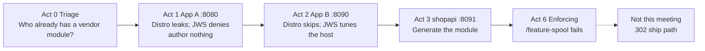

# 301 — Three-app customer talk

**Finish [104](../training/104-HAND-BUILT-MODULE.md) and [202](../tool/202-TOOL-LAB.md) before Acts 0, 1, 2, 3, and 6.** Those guides are the typed shopapi loop and the same loop with the scripts. This talk assumes those commands. Each act links to the command that was taught in [102](../training/102-COMMANDS.md).

**LAST_VERIFIED:** 2026-10-09 — live shopapi customer talk on rhel-qa. The host stayed Enforcing. App A/B ran on distro Tomcat (`tomcat_t`, unconfined) + JDK 17. JWS 6 + `jws6-tomcat-selinux` is the confined App A/B path and was not rerun.

## Which demo

This repo has **two** talk tracks. They overlap on canary / soak / PR. They are not interchangeable. Pick one per audience:

| | Audience | Setup | Length | Command |
|---|----------|--------|--------|---------|
| **This guide (301)** | Customer / first conversation | One RHEL host | ~20 min | `bash lab/demo_present.sh` |
| **[302](302-TECHNICAL.md)** | Technical deep dive — proof the ship path is real | Mac + rhel-qa + rhel-prod | ~45 min | `bash lab/demo_e2e_mac.sh` |

Today's meeting is the first row. One sentence for the room: some apps need nothing, some need a one-line host fix, and one app needs a new policy module.

Use `--profile customer`. That is Acts 0, 1, 2, 3, and 6, about 20 minutes. Act 6 is last: it drops `shopapi_t` from the permissive list. `--profile technical` is Acts 0–5 (the pull request, then a pointer at the 302 talk). It does not run Act 6. Act 5 does not run the 302 talk.

On a laptop, `--dry-run` prints this talk and runs nothing. `make check` runs the offline tests, including a dry-run of both talk scripts. The sample module in those tests is `selinux/myapp/myapp.te`. Nothing starts an application.



| Act | What you show | Where you stop |
|-----|----------------|----------------|
| **0** | Tomcat already has a Red Hat module. Shopapi does not. | You do not write a policy file for Tomcat. |
| **1** | Distro Tomcat returns the forbidden page. JWS returns DENIED. | You do not write a policy file. |
| **2** | Distro Tomcat has no denial, so the fixes are skipped. JWS needs the port, the file label, and the boolean. | You do not write a policy file. `git status` of `selinux/` stays empty. |
| **3** | Shopapi on port 8091. Curl `/health`, `/state`, and `/log`, then generate the module from those denials. | You do not open `/feature-spool` in this act. |
| **6** | Take `shopapi_t` off the permissive list. `/log` still works. `/feature-spool` fails, and the denial says `permissive=0`. `getenforce` still prints Enforcing. | Generate adds only the spool rule. This is the last act of the customer profile. |

The next meeting, when they want Ansible, RPMs, and the soak gate, is [302-TECHNICAL.md](302-TECHNICAL.md).

If you run `--help` on either talk script, the help text names the other script. The customer story is edited in `lab/demo_present.sh`. The two-VM story is edited in `lab/demo_e2e_mac.sh`, `demo_e2e_rhel_qa.sh`, and `demo_e2e_rhel_prod.sh`.

## The three apps

Customers run Tomcat, JBoss, Python, Node, and Spring Boot. Red Hat already ships policy for some of those. This talk uses three apps so a listener can point at their own:

| App | The story you tell | What you do on screen |
|-----|--------------------|------------------------|
| **App A** | Tomcat on port **8080**. Distro `tomcat_t` is unconfined. JWS `jws6_tomcat_t` is confined. | Distro: the forbidden page leaks. JWS: the same page is DENIED. Write no policy file. |
| **App B** | A second Tomcat. Port 8080 was taken, so it listens on **8090**. Its files were dropped in `/opt/appdata`. It calls a payment service. | Distro: say there was no denial. JWS: one command each for the port, the label, and the boolean. Write no policy file. |
| **shopapi** | A Spring Boot service started by systemd. Red Hat does not ship a module for it. | This is the only app that gets a new `.te`. |

App A and App B both run as `tomcat_t` (or both as `jws6_tomcat_t` on JWS). A second Tomcat instance does not get its own type ([`tomcat_domain_template(tomcat)`](https://github.com/fedora-selinux/selinux-policy/blob/c9s/policy/modules/contrib/tomcat.te) declares one domain). SELinux treats them as the same kind of program. Separating them needs a distinct domain for each, or MCS categories, which is what containers use.

**What this RHEL host will show.** Bootstrap installs the Tomcat that comes with RHEL. Its type is `tomcat_t`. A module named `tomcat` is loaded, and that type still does not confine the process. In Act 1 the forbidden page is readable (`UNEXPECTED_READ`) and there is no denial. In Act 2 the three probes produce no denial, so you skip the fixes and say so. Say that out loud. It is the honest result on this host.

JBoss Web Server (JWS) is the paid Tomcat. Its type is `jws6_tomcat_t`, and that type does confine. On a JWS host Act 1 shows a real denial, and Act 2 shows the one-line port, label, and boolean fixes. Bootstrap prints which Tomcat it installed.

Shopapi is confined on either kind of host. Act 3 is the same story both ways.

## Commands

You narrate. The script types the act commands and pauses. Press Enter when it says `Press Enter for the next step`. Do not type the act commands yourself while it is running.

On a laptop, with no RHEL, this prints the narration and the commands and runs nothing. The default variant is distro Tomcat (`tomcat_t`, unconfined). `--variant jws` prints the confined `jws6_tomcat_t` host instead.

```bash
bash lab/demo_present.sh --dry-run --profile customer
bash lab/demo_present.sh --dry-run --profile customer --variant jws
```

### Order for the meeting

**1. On the Mac**, only when this VM already ran **104**. The script SSHs to rhel-qa. It puts the types-only shopapi seed back, writes `/var/lib/selinux-pac-demo/ausearch-since`, and removes the App B port and file-label tunings so Act 2 still has something to show. It does not stop `auditd` or change `/var/log/audit`. Later `ausearch -ts` starts at that timestamp.

```bash
bash lab/reset_demo_vms.sh --dev-only
```

**2. On rhel-qa**, from the repo root. Bootstrap installs App A, App B, and shopapi if they are missing. It is safe to run again. It prints whether Tomcat is distro `tomcat_t` or JWS `jws6_tomcat_t`. Preflight prints a pass/fail table and exits. `Preflight PASSED` is the line you want. A WARN that distro `tomcat_t` is unconfined still passes. The last command is the talk.

```bash
sudo bash lab/demo_bootstrap.sh
bash lab/demo_present.sh --preflight
bash lab/demo_present.sh --profile customer
```

| Flag | Meaning |
|------|---------|
| `--profile customer` | Acts 0, 1, 2, 3, and 6 (~20 min): triage, App A, App B, generate shopapi, then the enforcing payoff |
| `--profile technical` | Acts 0–5. The enforcing payoff stays on the customer profile. Act 5 points at `demo_e2e_mac.sh` and does not run it. |
| `--acts 0,1,2` | Manual act list |
| `--preflight` | Pass/fail table. Missing App A → `make demo-bootstrap`. **Already-tuned App B** (port 8090 labelled, `/opt/appdata` fcontext, or connect boolean on) is a **FAIL** — Act 2 would produce no denial. |
| `--dry-run` | Narration + commands + expected output; **executes nothing** |
| `--open-pr` | Preflight requires `gh auth` |
| `--no-step` | Run each command as soon as it is typed (no Enter wait) |
| `--auto` | Never wait for Enter (CI) |

A second Act 2 on the same VM uses the same Mac reset as step 1, then `--preflight` again.

The three-host generate/canary/soak talk is **[302](302-TECHNICAL.md)** (`demo_e2e_mac.sh` / `_rhel_qa.sh` / `_rhel_prod.sh`), not this script.

## What you say, command by command

`--profile customer` is Acts 0, 1, 2, 3, and 6. Each command waits for Enter before it runs. `--no-step` runs each command as soon as it is typed. `--auto` never waits (CI).

### Before anyone is watching

`sudo bash lab/demo_bootstrap.sh` stands up the three apps. Bootstrap prints whether Tomcat is distro `tomcat_t` or JWS `jws6_tomcat_t`. On this RHEL it is distro `tomcat_t`.

`bash lab/demo_present.sh --preflight` prints a pass/fail table and exits. It does not start the talk.

| Row | Pass means | Fail means |
|-----|------------|------------|
| Enforcing | `getenforce` is Enforcing. The talk never runs `setenforce 0`. | The host is Permissive or Disabled. |
| Tomcat unit and port 8080 | App A is installed and listening. | Run bootstrap. |
| Port 8090 | Not labeled yet. **PASS** if nothing is listening. **WARN** if it is already listening with no label. That WARN is normal on this host: distro Tomcat can bind the port, so Act 2 will not show a bind denial. | **FAIL** only when the port is already labeled. Reset from the Mac. |
| App B fcontext | `/opt/appdata` has no custom mapping yet. | Already mapped. Same reset. |
| App B boolean | The outbound-connect switch is off. | It is on. Same reset. |
| App A denials | A **WARN** on distro `tomcat_t` is expected. The type is unconfined, so Acts 1 and 2 will not produce file or port denials. Shopapi in Act 3 still confines. | A missing App A is a FAIL, not this WARN. |

`Preflight PASSED` is the line you want before the meeting. A WARN on unconfined `tomcat_t` still passes.

### Act 0 — Triage

Say: three apps. We do not write a policy module until the third.

```bash
sepac triage tomcat
```

Read the TRIAGE line aloud. On this host: `situation=loaded_unconfined`, `action=confine`. The module is loaded but `tomcat_t` does not confine. JWS would say `situation=loaded`, `action=tune`.

```bash
sepac triage shopapi
```

`situation=none`, `action=generate`. shopapi has no Red Hat module. This is the only app we will write policy for.

### Act 1 — App A

Say: triage found an unconfined app on port 8080. The host is Enforcing but `tomcat_t` does not confine. We change nothing.

```bash
getenforce
```

One word. `Enforcing` means denials are real. The host stays this way for the whole talk.

```bash
ps -eo label,comm | grep -E 'tomcat|jsvc'
```

The third field is the process type. Distro Tomcat is `tomcat_t`. JWS is `jws6_tomcat_t`.

```bash
curl -sS http://127.0.0.1:8080/standard/forbidden.jsp
```

This page reads a file the app should not touch. On **this** host it returns `UNEXPECTED_READ` because `tomcat_t` is unconfined. On a JWS host it returns `DENIED`.

```bash
seinfo -t tomcat_t -x | tr ',' '\n' | grep unconfined
```

Distro: `files_unconfined_type` and `unconfined_domain_type` prove the type is unconfined. No denial, no `ausearch` output. We authored nothing.

On a JWS host: `ausearch` shows `denied { read }` for `jws6_tomcat_t` instead of the `seinfo` line. The vendor domain is confined, and we still authored nothing.

### Act 2 — App B

Say: someone else had port 8080, so this one listens on 8090. The files landed in `/opt/appdata`. It calls a payment service. If a probe produces no denial, we skip the fix.

```bash
curl -s -o /dev/null -w '%{http_code}\n' http://127.0.0.1:8090/inherited/
```

Port 8090. `200` or `000` if Tomcat could not bind.

```bash
curl -sS http://127.0.0.1:8090/inherited/data.jsp
```

Data in `/opt/appdata`, labeled `user_home_t`.

```bash
curl -sS http://127.0.0.1:8090/inherited/gateway.jsp
```

Outbound call to the payment gateway.

```bash
sudo ausearch -m avc -ts recent | grep tomcat_t | audit2why || echo 'No tomcat_t denials'
```

`audit2why` turns each denial into a suggested fix. On this distro host: no denials, nothing to fix. On a JWS host the fixes run only when a denial is real: `semanage port -a` for the port, `semanage fcontext -a` + `restorecon` for the label, `setsebool -P` for the boolean.

One-line host fixes, only where a denial was real. Zero policy written.

### Act 3 — shopapi

Say: this is the first time we author a module. We declined twice. Spring Boot has no Red Hat module. `init_daemon_domain` puts the process in `shopapi_t`.

```bash
ps -o label=,comm= -C java
```

shopapi runs in its own domain, permissive for now: logged, not blocked.

```bash
for p in health state log; do curl -sS http://127.0.0.1:8091/$p; done
```

Use the app. These three URLs are the first-ship probes.

```bash
sepac denials shopapi
```

What SELinux logged. Each line is a denied access for `shopapi_t`, with `permissive=1`.

```bash
sepac generate shopapi
```

Generate policy from the log. This is **blocked**: `execmem` is a domain-weakening permission and requires `--approve execmem`.

```bash
sepac generate shopapi --approve execmem --apply
```

A reviewer approves `execmem`. `/etc/passwd` is refused. `bin_t` execute is accepted because `config/shopapi.manifest.yml` records `selinux_exceptions.exec_bin`.

```bash
sepac load shopapi
```

Load it on QA. Production gets a signed RPM, not `semodule -i`.

### Act 6 — Enforcing payoff

Say: take `shopapi_t` off the log-only list. `getenforce` stays Enforcing.

```bash
sudo semanage permissive -d shopapi_t
```

Turn enforcement on for shopapi only.

```bash
for p in health state log; do curl -sS http://127.0.0.1:8091/$p; done
```

Same calls, now enforced. They still work.

```bash
curl -sS http://127.0.0.1:8091/feature-spool
```

A new feature the policy has never seen. HTTP 500 — the spool write is denied.

```bash
sepac denials shopapi --enforced
```

The denial says `permissive=0` and names `/var/spool/shopapi`. This is real enforcement.

```bash
sepac generate shopapi --apply
```

Generate again. No `--approve` this time — the spool rule does not weaken the domain.

```bash
sepac load shopapi
```

Load it and fix the label. `restorecon` relabels the spool directory.

```bash
curl -sS http://127.0.0.1:8091/feature-spool
```

Try again. HTTP 200 — the spool write is allowed.

```bash
sepac status shopapi
```

Still Enforcing. `shopapi_t` is not on the permissive list. Blocked, labeled, fixed. The host never left Enforcing.

## Remember while you talk

- App A and App B come before the generator. That order is the point.
- Act 1 always includes the forbidden page. On this host, follow it with `seinfo` and an empty `ausearch`. On JWS, follow it with the denial.
- Act 2: a probe with no denial is a spoken skip. `--tune-report` writes those same host commands into `policy_out/tune_report.md` and does not write a `.te`. Close on the empty `git status` and the unchanged module count.
- Shopapi allows come from the denials just produced. The first generate is blocked on `execmem`. The rerun with `--approve execmem` writes it only because it was in the log. The JVM is `bin_t` on RHEL 9 (`java_exec_t` is an alias of `bin_t` in [`corecommands.te`](https://github.com/fedora-selinux/selinux-policy/blob/c9s/policy/modules/kernel/corecommands.te)). The generator writes `corecmd_exec_bin(shopapi_t)` for that execute only because the manifest records `selinux_exceptions.exec_bin`. It does not write an entrypoint on `bin_t`. The wrapper, after `restorecon`, is the entrypoint.
- Act 6 opens `/feature-spool` after `shopapi_t` leaves the permissive list. `getenforce` still prints `Enforcing`.

## Self-service

| Who | Path |
|-----|------|
| New to SELinux | [104-HAND-BUILT-MODULE.md](../training/104-HAND-BUILT-MODULE.md) first, then this talk. |
| Us (maintained host) | App A persists. `--preflight` the night before. Act 1 is evidence. |
| Colleague on a throwaway VM | `make demo-bootstrap` (idempotent; resume after Ctrl-C). |
| Customer after the meeting | Same bootstrap + `--dry-run` on a laptop first. |
| Laptop, no RHEL | [202 — laptop](../tool/202-TOOL-LAB.md#laptop-no-selinux) + `--dry-run`. `make check` uses deterministic fixtures (no live app). |

`payments/` remains a **CI multi-module fixture**, not a talk app.

## What is not in this talk

- A live Flask app — `make check` is deterministic goldens + smoke, not HTTP to :8888.
- Generating a `.te` for Tomcat App A or App B.
- `semodule -i` (or `audit2allow`) on prod.

**Ship path after generate:** [302-TECHNICAL.md](302-TECHNICAL.md) → [401-OPERATIONS.md](../admin/401-OPERATIONS.md).
