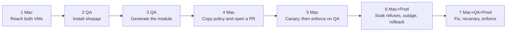
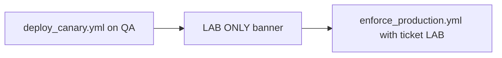
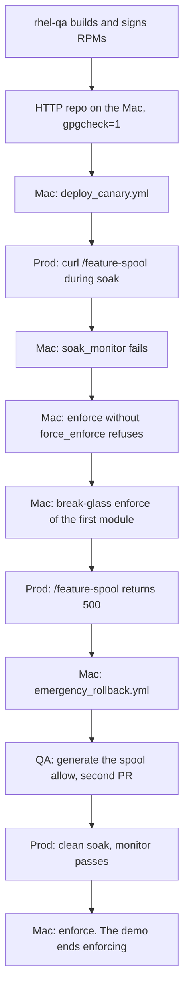

# 302 — The two-host lab: sepac from QA to production

This is the meeting after [the sepac demo](../demo.md), which is one host and about 20 minutes. This one is about 45 minutes and uses three windows: the Mac runs the Ansible side of sepac, rhel-qa writes the policy, rhel-prod only ever receives signed RPMs. Do not open it for someone who has not seen the first demo. The commands are in [sepac.md](../sepac.md); the lifecycle is [shipping.md](../shipping.md).

Lab plumbing (inventories, rsync, scp between the VMs, serving the repo, host packages) runs quietly: one grey line each, not typed, no Enter. Only sepac commands are typed on screen.

**LAST_VERIFIED:** 2026-10-09 — live Mac + rhel-qa + rhel-prod, before the talk scripts switched to sepac commands. Rehearse the current version once before a customer sees it. The host stayed Enforcing. Prod printed `HTTP/1.0 200 OK` for the repo key, then the soak gate refused, and the demo ended with `shopapi_t` enforcing.

**Short happy path (~20 min):** `bash lab/demo_e2e_mac.sh --short`. Generates a complete module (all four URLs including `/feature-spool`) on QA, then ships to prod. Soak passes on the first try. No outage, no rollback, no second generate. The demo still ends enforcing.

The app is Spring Boot **shopapi**. The Mac does not run SELinux. It drives two RHEL VMs over SSH.



The Mac script is the conductor. It prints when to switch windows. Parts 2 and 3 are the QA window, so the Mac banner jumps from Part 1 to Part 4. That skip is expected.

Press Enter when a window says `Press Enter`. Look at the prompt before you paste.

| Window | Prompt you must see | Start |
|--------|---------------------|--------|
| **Mac** | `$USER@… selinux-pac %` | `cd` to this repo, then `bash lab/demo_e2e_mac.sh` |
| **QA** | `[ansible@rhel-qa ~]$` | `ssh $SSH_USER@$QA_HOST` |
| **Prod** | `[ansible@rhel-prod ~]$` | `ssh $SSH_USER@$PROD_HOST` |

`$QA_HOST` and `$PROD_HOST` are the addresses in the inventory this laptop uses. If `ping` fails after a VM was recreated, put the new addresses in those variables. If the prompt already says `rhel-qa` or `rhel-prod`, you are on that VM. Do not `ssh` again.

A second run on the same VMs starts on the **Mac**:

```bash
bash lab/reset_demo_vms.sh
```

That unloads leftover shopapi modules and prod RPMs, puts the types-only seed back, and writes `/var/lib/selinux-pac-demo/ausearch-since`. It does not stop `auditd` or change `/var/log/audit`. Later `ausearch -ts` starts at that timestamp. It does not remove Java.

To read the narration on a laptop without the VMs: `bash lab/demo_e2e_mac.sh --dry-run`.

## Part 1 — Mac: lab setup

No SELinux here: the Mac has no `getenforce`. Four grey lines: the two inventory files are written and both VMs answer over SSH, both hosts are Enforcing with `ausearch` and `sesearch`, this checkout is rsynced onto rhel-qa at `~/selinux-pac`, and a small bundle (the prod talk track, the bootstrap, the shopapi source) is copied to `~/e2e-demo` on prod. Prod never gets a clone.

Say: this laptop is the remote control. QA is where we write policy. Prod only receives RPMs.

## Part 2 — QA: collect the evidence

The Mac tells you to run:

```bash
bash ~/selinux-pac/lab/demo_e2e_rhel_qa.sh --part app
```

Grey lines first: the hostname, the packages, and `demo_bootstrap.sh --shopapi-only`, which installs the service, the wrapper at `/opt/shopapi/bin/shopapi` and the types-only seed, with `shopapi_t` permissive. Then:

```bash
sepac status shopapi
sepac capture shopapi --full-audit
```

Status: host Enforcing, the seed module loaded, `shopapi_t` permissive, the process running as `shopapi_t`. Capture turns dontaudit rules off, restarts shopapi, calls `/health`, `/state` and `/log` from the manifest (not `/feature-spool`: that is the outage on prod, later), puts dontaudit back, and summarises the denials. With `--short`, capture also calls `/feature-spool`, so the first module is complete.

Go back to the Mac. It copies the JAR QA just built onto prod, so prod does not need Maven, and prod's `--part app` installs shopapi unconfined.

## Part 3 — QA: write the policy

Still on QA, when the Mac says so:

```bash
bash ~/selinux-pac/lab/demo_e2e_rhel_qa.sh --part generate
```

```bash
sepac generate shopapi --apply --approve execmem
sepac check shopapi
sepac load shopapi
```

`--approve execmem` is the reviewed approval for this JVM; `/etc/passwd` stays refused. `/usr/bin/java` is a `bin_t` file (on RHEL 9 `java_exec_t` is an alias of `bin_t`, [`corecommands.te` on c9s](https://github.com/fedora-selinux/selinux-policy/blob/c9s/policy/modules/kernel/corecommands.te)), so the JVM execute becomes `corecmd_exec_bin(shopapi_t)`, accepted only because `config/shopapi.manifest.yml` records `selinux_exceptions.exec_bin`. `check` is the CI gate. `load` loads the module on QA, relabels the shopapi paths and labels TCP 8091 `shopapi_port_t`. Go back to the Mac. Do not canary yet.

## Part 4 — Mac: copy the policy and open a pull request

A grey line copies `shopapi.te`, `shopapi.fc`, `policy_version.txt` and `shopapi.pp` from QA into this checkout. Then `sepac check shopapi` (on the Mac it runs the manifest and forbidden-pattern checks and says compile is skipped) and `demo_open_generated_pr.sh` opens the pull request when `gh` is logged in. A rehearsal opens it as a draft labelled do-not-merge.

Say: the policy was written on QA; the pull request is on this laptop's checkout; prod still does not generate policy.

## Part 5 — Mac: canary, then enforce on QA

[deploy_canary.yml](201-TOOL-COMMANDS.md#ansibledeploy_canaryyml) on QA. Day 0 of a production soak installs the RPM. It does not `semodule -i`.



Say: canary loads the module and leaves only `shopapi_t` in log-only mode. The rest of the machine stays Enforcing.

```bash
sepac canary --env dev
```

A good playbook ends with `failed=0`.

QA’s inventory has `soak_min_days: 0` so this talk can lock the domain down immediately. The script prints a red **LAB ONLY** banner there. Production’s inventory stays at 7 days. Do not copy the zero onto prod.

```bash
sepac enforce --env dev --ticket LAB
```

After this, `getenforce` is still `Enforcing` and `shopapi_t` is no longer permissive.

## Part 6 — Prod soak refuses, then the outage and rollback

[ausearch](102-COMMANDS.md#ausearch--m-avc), then [soak_monitor.yml](201-TOOL-COMMANDS.md#ansiblesoak_monitoryml). The gate fails closed when `sesearch` is missing. Enforce without `force_enforce` is [enforce_production.yml](201-TOOL-COMMANDS.md#ansibleenforce_productionyml). The production install is the RPM at priority 200, not a hand `semodule -i` at 400.



Say: prod does not clone the repo. Policy arrives as two RPMs, `selinux-policy-ops` and `shopapi-selinux`, and only after the pull request is on `main`.

Real use builds the RPMs only after the PR is on `main`. This rehearsal does not merge its PRs (main keeps the types-only seed), so rhel-qa builds from the module it just generated (`BUILD_RPMS_ALLOW_DIRTY=1`). Never `git pull` before that step — it would replace the generated module with the seed.

A grey line installs the packaging tools on rhel-qa and runs `lab_signing_setup.sh` there: a lab key and a repo file with `gpgcheck=1`; it never prints the private key. Then the Mac types `ssh … 'sepac build --allow-dirty && sepac publish'` against rhel-qa. The private key stays there. rhel-qa builds and signs the RPMs. UTM does not route one VM to the other, so the conductor rsyncs `dist/lab-repo` onto the Mac and serves it there. The copy has the public key, the signed RPMs, and repodata, and not the private key. Prod curls `http://<REPO_HOST>:8765/RPM-GPG-KEY` and should print `HTTP/1.0 200 OK`. Prod's inventory points `selinux_rpm_repo_baseurl` and `selinux_rpm_gpgkey` at that URL. There is no `rpm -Uvh`.

Canary is the install. The Mac runs `sepac canary --env production --limit canary`. That copies the RPMs to prod with `dnf` (`gpgcheck=1`), sets `shopapi_t` permissive, and restarts the service. Prod `--part rpms` is available for manual inspection (`dnf repolist`, `rpm -q gpg-pubkey`); the conductor does not switch to prod for it. The canary also installs `selinux-pac` and the manifest on prod, so the prod window can use sepac from here on.

```bash
sepac canary --env production --limit canary
```

On prod, `--part soak` runs `sepac capture shopapi --no-restart --url /feature-spool`. The domain is permissive, so the page still returns 200, and capture shows the new denial for `/var/spool/shopapi`. `sepac denials shopapi` shows the raw lines, and a grey line saves them in `/tmp/prod-feature-spool.avc` for rhel-qa.

The Mac then runs `sepac soak`. It must fail. `--part soak-avc` shows `/var/lib/selinux-policy-ops/shopapi/selinux_soak_last_fail.avc`. That directory is where the soak monitor writes the fail files. Leave them in place. A later canary writes a new marker, and daily files and fail files older than that marker do not count.

Enforce omits both flags. `skip_soak_days` skips only the day count and the daily history. `force_enforce` skips the marker, the AVC gate, net-new, the report, the day count, and the daily history, and it requires `break_glass_reason`. The playbook refuses. `shopapi_t` stays permissive.

```bash
sepac enforce --env production --ticket DEMO
```

Expected: non-zero. The refusal to show is the failed soak. Do not pass `force_enforce` to hide the denial.

## Part 7 — Outage, then the fix, then enforce

[emergency_rollback.yml](201-TOOL-COMMANDS.md#ansibleemergency_rollbackyml) is [semanage permissive -a](102-COMMANDS.md#semanage-permissive). `getenforce` stays Enforcing.

This beat is before the fix. The first module is loaded and does not allow `/var/spool/shopapi`. Break-glass enforce of that module makes `/feature-spool` return 500. Roll back, then generate the allow.

```bash
sepac enforce --env production --ticket DEMO --break-glass 'show the enforcing denial before the fix'
```

On prod:

```bash
bash ~/e2e-demo/demo_e2e_rhel_prod.sh --part fail
```

`sepac capture shopapi --no-restart --url /feature-spool` shows HTTP 500, and the denial: `shopapi_t` opening a `var_spool_t` file, blocked.

On the Mac:

```bash
sepac rollback --env production
```

That puts `shopapi_t` back in log-only mode so the app runs again. `sepac status shopapi` shows the host is still Enforcing and shopapi_t is permissive. Prod `--part restore` runs `sepac status shopapi`. We still do not run `semodule -i` on prod.

The Mac copies `/tmp/prod-feature-spool.avc` to QA as `~/selinux-pac/policy_out/avc.log`. On QA, `--part generate --skip-export` writes the spool allow. Merge that PR. Recanary QA, rebuild the RPMs, and canary prod again.

On prod, `--part soak-clean` runs the same `sepac capture`: every endpoint returns 200 and there are no new denials. `sepac soak` passes (`failed=0`).

`soak_status.yml` only reads status. The production inventory still wants 7 clean days. This recording cannot wait. The AVC gate already passed. `skip_soak_days` skips only the day count and the daily history. The marker, the AVC gate, net-new, and the report still run.

```bash
sepac enforce --env production --ticket DEMO --skip-soak-days
```

Expected: `shopapi_t` is enforcing. The demo ends enforcing.

## URLs

| When | What capture calls | Why |
|------|----------------|-----|
| First prod soak | `http://127.0.0.1:8091/health`, `/state`, `/log`, `/feature-spool` | The spool write is not in the first module. Permissive still returns a page; the denial fails the monitor. |
| Clean soak after the fix | same four URLs | The spool allow is loaded. Monitor passes. |
| Outage, allow not loaded | `http://127.0.0.1:8091/feature-spool` | Enforcing, and the module does not allow `/var/spool/shopapi/feature.log`. |

The port is `http.port` in `config/shopapi.manifest.yml`.

## Related

- Practice the commands first: [104-HAND-BUILT-MODULE.md](104-HAND-BUILT-MODULE.md)
- The 20-minute customer demo: [demo.md](../demo.md)
- Shipping for real, with AAP: [shipping.md](../shipping.md)
- What to do when a denial shows up after ship: [shipping.md](../shipping.md#a-denial-after-ship)
