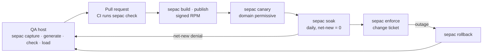
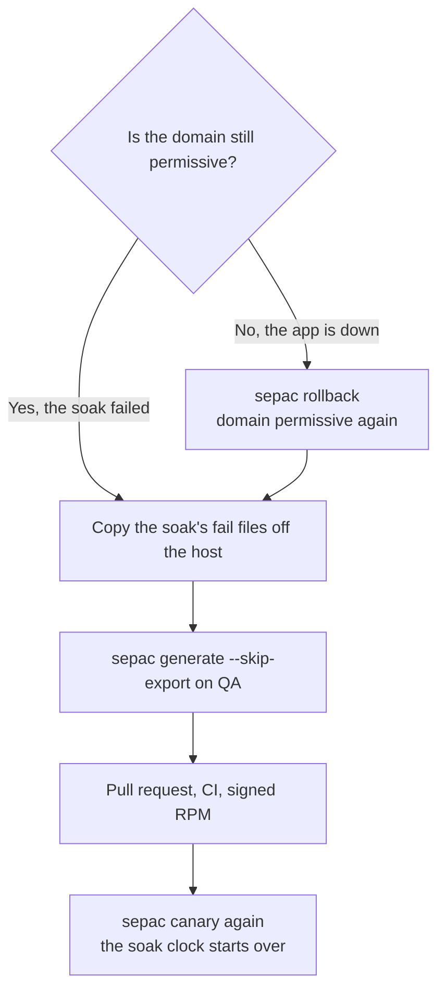

# Shipping a policy with sepac

From the QA host to production: write the policy, review it as a pull request, build a signed RPM, canary it with the app's domain permissive, soak it, enforce it. A denial after ship becomes another pull request, never `semodule -i` typed on a server. The host stays **Enforcing** throughout; only the app's domain is ever permissive, and only during capture and the soak.



| Step | Where | Command |
|------|-------|---------|
| Write and try the policy | QA host, git checkout | `sepac capture`, `generate`, `check`, `load` |
| Review | The app's git repo | Pull request; CI runs the same checks as `sepac check` |
| Package | QA host or a build host | `sepac build`, `sepac publish` |
| Canary, soak, enforce, rollback | Where Ansible runs, or AAP | `sepac canary`, `soak`, `enforce`, `rollback` |
| Look at a host | Any host with sepac | `sepac status`, `sepac denials` |

Production never gets a git clone. It gets the `APP-selinux` RPM, the `selinux-policy-ops` host scripts and `selinux-pac`, all from the signed internal repo.

## Where policy lives

| Place | What it holds |
|-------|---------------|
| **The app's git repo** | `selinux/APP/` (`.te`, `.fc`, `policy_version.txt`) and `config/APP.manifest.yml`. Policy pull requests land here. |
| **This repo, or your fork** | sepac, the generator, the playbooks, the host scripts. Not the allow list for your product. |
| **The QA host** | The app, its audit log, `selinux-policy-devel`. Policy is written and compiled here. |
| **Production** | RPMs and AAP. No git clone. |

### Policy CI for an app repo

An app repo calls [`.github/workflows/selinux-policy-app.yml`](../.github/workflows/selinux-policy-app.yml). That file is `workflow_call` only: in a called workflow the `github` context is the caller's, so the tools repo and ref are inputs. Copying [`.github/workflows/selinux-policy-ci.yml`](../.github/workflows/selinux-policy-ci.yml) into the app repo does not work, because the validators live in this repo, not next to the app.

Put this in the app repo as `.github/workflows/selinux-policy.yml`. `OWNER/selinux-pac` is the fork you trust and `REF` a commit or tag on it. Pass the same ref as `tools_ref` so the scripts match the workflow file.

```yaml
name: SELinux policy
on:
  pull_request:
  push:
    branches: [main]
jobs:
  policy:
    uses: OWNER/selinux-pac/.github/workflows/selinux-policy-app.yml@REF
    with:
      policy_dir: selinux/shopapi
      module: shopapi
      domain: shopapi_t
      manifest: config/shopapi.manifest.yml
      tools_repo: OWNER/selinux-pac
      tools_ref: REF
```

The called jobs run the forbidden-pattern check, the source audit, version consistency, and the compiled and semantic checks on CentOS Stream 9. Put `selinux/` under CODEOWNERS (or a required check) so an app-only merge cannot skip them.

## 1. Write the policy on QA

```bash
sepac triage shopapi                          # Red Hat's policy first
sepac capture shopapi --full-audit            # evidence: restart, call the endpoints
sepac generate shopapi                        # stops on execmem
sepac generate shopapi --approve execmem --apply
sepac check shopapi
sepac load shopapi --enforcing                # try it enforcing on QA
sepac capture shopapi --no-restart            # no new denials?
```

Commit `selinux/shopapi/` and open the pull request. `policy_out/pr_body.md` is a ready pull-request description.

### Vendor module already exists

Before writing policy for Tomcat, JBoss/EAP, Apache httpd, BIND or PostgreSQL, `sepac triage` checks whether Red Hat already ships the domain. A second module that half-copies `jws6_tomcat` or a base module is worse than no custom policy, so `generate` refuses unless you pass `--force "reason"`. The reason is recorded for the pull request; a bare `--force` is rejected.

RHEL 9 base module names are what `semodule -l` prints: [apache.te](https://github.com/fedora-selinux/selinux-policy/blob/c9s/policy/modules/contrib/apache.te) is `apache` (domain `httpd_t`), [bind.te](https://github.com/fedora-selinux/selinux-policy/blob/c9s/policy/modules/contrib/bind.te) is `bind` (domain `named_t`). Confined JBoss/EAP comes from the `eap7-selinux` or `eap8-selinux` package; there is no base JBoss module on the `c9s` branch. Distro Tomcat runs as `tomcat_t`, which RHEL ships unconfined; JBoss Web Server's `jws6-tomcat-selinux` is the confined one. Until a vendor package is enabled, a Tomcat or EAP process runs `unconfined_service_t`. The triage table is in [sepac.md](sepac.md#triage).

### Booleans

A boolean the app needs goes in the manifest, not in the `.te`. The canary applies each entry with `ansible.posix.seboolean` after the module is installed and before the service starts.

```yaml
selinux_booleans:
  - name: tomcat_read_rpm_db
    state: true
```

`tomcat_read_rpm_db` is a tunable in [tomcat.te](https://github.com/fedora-selinux/selinux-policy/blob/c9s/policy/modules/contrib/tomcat.te), as are `tomcat_can_network_connect_db` and `tomcat_use_execmem`. There is no `tomcat_can_network_connect`; the manifest check rejects it, and rejects `httpd_can_network_connect` on a Tomcat domain.

## 2. Build and publish

```bash
sepac build                                   # selinux-policy-ops, selinux-pac, one RPM per app module
sepac publish                                 # signs and publishes; reads packaging/internal.env
```

`packaging/internal.env.example` lists the settings. The signing key stays on the build host. Hosts install with `gpgcheck=1`.

## 3. Canary

Once per controller, create the inventory (it is gitignored) and set the real host names. The `canary` group is what `--limit canary` selects.

```bash
cp ansible/inventory.production.example.yml ansible/inventory.production.yml
sepac canary --env production --limit canary
```

The canary installs the RPM (the module lands at priority 200), applies the manifest's ports and booleans, puts **only** the app's domain on the permissive list, restarts the service and checks it runs as the app's domain, calls the manifest's endpoints, and starts the soak clock. It also turns dontaudit rules off for the host (`semodule -DB`) so the soak sees every denial; enforce and rollback put them back unless another app is still soaking.

A good run ends `failed=0`, the process is `shopapi_t` (not `init_t`), the endpoints answer, and recent denials are 0. The label check runs on the host before the restart. To run it yourself on a production host:

```bash
sudo /usr/libexec/selinux-policy-ops/verify_file_contexts.sh \
  --install-root /opt/shopapi --var-dir /var/lib/shopapi --log-dir /var/log/shopapi --app-name shopapi
```

## 4. Soak

```bash
sepac soak --env production --limit canary            # schedule daily (AAP: Soak monitor)
sepac soak --env production --limit canary --status   # read-only: days elapsed, counts
```

Each run counts **net-new** access: what the domain was denied that the installed policy does not already allow. `sesearch` makes that comparison, so repeated denials for an access the policy allows do not fail the gate, and a missing `sesearch` fails closed instead of reporting a clean window. Denials listed in the manifest's `soak.ignore` are reported separately and do not fail it. Each day's result is stored under `/var/lib/selinux-policy-ops/APP/daily/`; a later clean reading does not erase a stored failure.

On a host, `sepac capture shopapi --no-restart` and `sepac denials shopapi` show the same evidence.

Before you enforce, confirm:

- [ ] The soak has run at least `soak_min_days` (7 on the production inventory), across a business cycle including a weekend
- [ ] `sepac status APP` shows the domain permissive, the labels ok, the service running as the app's domain
- [ ] A change ticket names the window and who runs rollback
- [ ] The policy pull request was reviewed

## 5. Enforce

```bash
sepac enforce --env production --limit canary --ticket CHG123
```

The playbook checks the soak gate itself: the canary marker exists, enough days passed, net-new is 0, the deploy report passed. Then it takes the domain off the permissive list and runs the endpoint checks again. `getenforce` was `Enforcing` before and still is. In AAP, **Promote to enforce** runs Soak status, an approval, then this playbook.

Two flags exist for demos and emergencies, and both still need the ticket:

- `--skip-soak-days` skips only the day count and the daily history. The AVC gate, net-new and the report still run.
- `--break-glass "reason"` skips the marker, the AVC gate, net-new, the report and the day count, and records the reason in the deploy report.

## A denial after ship



Do not enforce while the soak is failing. Do not run `setenforce 0`. Do not pipe `audit2allow` into `semodule` on the server.

1. If the app is enforcing and down, run `sepac rollback --env production`. The domain is permissive again, the host stays Enforcing, and `rollback_dnf_version` can downgrade the RPM.
2. Copy `/var/lib/selinux-policy-ops/<app>/selinux_soak_last_fail.json` and `selinux_soak_last_fail.avc` off the host, into `policy_out/avc.log` on QA.
3. On QA: `sepac generate APP --skip-export --apply`. If triage says the app is vendor-covered, use `sepac tune APP` instead.
4. Open the pull request on the app repo. CI runs the checks.
5. `sepac build`, `sepac publish`, `sepac canary` again. The soak clock starts over.

| The denial | Change this in git | Not the lasting fix |
|------------|--------------------|---------------------|
| A file path | `.fc` (sepac writes it), applied by the canary's `restorecon` | A one-off `semanage fcontext` on the box |
| A port bind | `selinux_ports` in the manifest | A one-off `semanage port -a` on the box |
| A boolean | `selinux_booleans` in the manifest | A raw allow copying the boolean into the `.te` |
| A new permission | An allow in the `.te`, after the gate | `audit2allow` piped into `semodule -i` |

`ansible/generate_emergency_patch.yml` runs the generator on the controller, in a git checkout. It writes `policy_out/` for that pull request and installs nothing on a production host.

## The AAP jobs

Click-create the objects from [`ansible/aap/`](../ansible/aap/), or apply [`ansible/aap/aap_configuration.yml`](../ansible/aap/aap_configuration.yml) with `infra.aap_configuration`: job templates, both workflows, the enforce survey and the daily soak schedule. Playbook details are in [`ansible/README.md`](../ansible/README.md).

| Job | sepac equivalent | When |
|-----|------------------|------|
| SELinux – Canary | `sepac canary` | After the RPM exists |
| SELinux – Soak monitor | `sepac soak` | Daily on the canary group. Attach a notification on failure. |
| SELinux – Soak status | `sepac soak --status` | First step of Promote to enforce. Changes nothing. |
| SELinux – Enforce | `sepac enforce --ticket T` | After approval. The survey requires `change_ticket`. |
| SELinux – Rollback | `sepac rollback` | The app is down. Not on the promote graph. |

| Variable | Usual value | What it does |
|----------|-------------|--------------|
| `change_ticket` | `CHG123` | Required by enforce |
| `app_manifest_path` | `/etc/shopapi/selinux-manifest.yml` | Installed by the `shopapi-selinux` RPM |
| `selinux_pac_host_role` | `production` | Written to `/etc/selinux-pac/role` |
| `soak_min_days` | `7` on prod, `0` on the lab QA inventory | Never copy the 0 onto production; enforce refuses it on the `production` group |
| `soak_max_net_new` | `0` | Net-new access that fails the soak |
| `skip_soak_days`, `force_enforce` | `false` | What `--skip-soak-days` and `--break-glass` set |
| `rollback_dnf_version` | previous NVR | Optional RPM downgrade during rollback |

## Roll this out

- [ ] The app repo has `selinux/APP/`, `config/APP.manifest.yml` (`sepac init APP`) and the policy CI above
- [ ] CODEOWNERS covers `selinux/`
- [ ] A signed internal repo: `cp packaging/internal.env.example packaging/internal.env`, then `sepac publish`
- [ ] Inventories exist and SSH works (`lab/setup_rhel_hosts.sh write`, then `ping`, for a lab)
- [ ] AAP points at `ansible/`, with the soak monitor scheduled daily and a failure notification
- [ ] Production hosts have `selinux-policy-ops`, `selinux-pac` and `setools-console`, and no git clone

## When something fails

| What you see | What to do |
|--------------|------------|
| `Soak not met` | Wait; the message prints the days elapsed and the number required |
| `Net-new access needs` above the threshold | Follow [A denial after ship](#a-denial-after-ship). The recanary resets the clock. |
| `verify_file_contexts.sh` names a path | On that host, `restorecon -Rv` the path (the labels come from the installed policy), then run `/usr/libexec/selinux-policy-ops/verify_file_contexts.sh` again. `sepac status APP` shows how many files differ. |
| `Canary marker missing` | Run `sepac canary` |
| `Soak daily history not met` | A day under `/var/lib/selinux-policy-ops/APP/daily/` is missing or failed. Wait for the next soak, or fix and recanary. |
| `Soak AVC monitor failed closed` | Install `setools-console` and `audit`. Do not enforce on a count of zero. |
| The app fails after enforce | `sepac rollback`, then the pull-request path above |
| `generate` says vendor policy is loaded | `sepac tune APP`, or install the vendor SELinux package |
| `Could not match supplied host pattern` | Copy `inventory.production.example.yml` to `inventory.production.yml` and set the real host names |
| `load` refuses: the role is not qa | Run it on the QA host. Production gets the RPM. |
